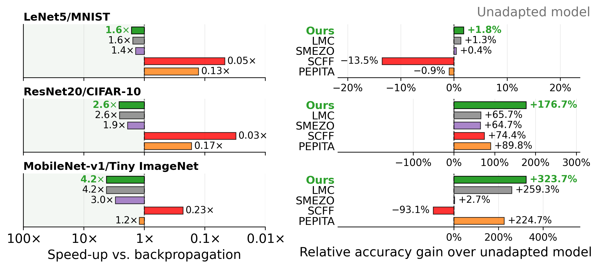
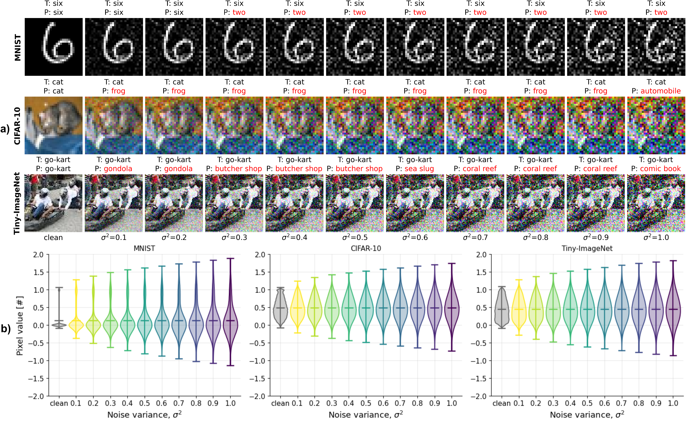

# BOLSTER

**CNN recalibration without backpropagation.**

**Official repository for _BOLSTER: Backpropagation-free Optimization via Lightweight Stochastic Tuning for Explainable CNN Recalibration_.**

BOLSTER helps pretrained convolutional neural networks recover accuracy when their inputs become noisy. It combines stochastic weight perturbations with a covariance-guided update schedule to reduce the cost of supervised model adaptation. Across the paper's three benchmarks, it delivers **1.6–4.2× faster adaptation** and **1.7–2.2× lower peak training memory** than full backpropagation retraining.

[Results](#results) · [Installation](#installation) · [Using this repository](#using-this-repository) · [Figures](#step-3-recreate-the-figures) · [Citation](#citation)



*Paper results averaged over Gaussian input-noise variances from 0.1 to 1.0. Left: speedup relative to full backpropagation retraining. Right: relative gain in mean accuracy over the unadapted model. “Ours” denotes BOLSTER.*

## Motivation



*Figure 1. Increasing Gaussian input noise degrades predictions across the three benchmarks. The top panels show clean and corrupted samples with true (T) and predicted (P) labels; the bottom panels show the corresponding pixel-intensity distributions.*

Retraining a deployed network can recover accuracy, but backward passes and stored activations make repeated adaptation expensive. BOLSTER uses two forward loss evaluations per minibatch to estimate a correction across the model's trainable parameters. A scalar covariance schedule, initialized from the pretrained weights and the epoch budget, controls the perturbation magnitude and update gain.

- **Forward-only adaptation:** Symmetric stochastic perturbations replace backpropagation through the network.
- **An interpretable update schedule:** Checkpoint statistics determine the scale of progressively smaller corrections.
- **Evidence across three CNNs:** LeNet-5/MNIST, ResNet-20/CIFAR-10, and MobileNet-v1/Tiny-ImageNet.
- **Ready-to-evaluate artifacts:** Saved checkpoints, self-contained evaluation notebooks, result workbooks, and figure-generation notebooks.

The covariance schedule is deterministic and conditioned on the starting checkpoint; it does not estimate uncertainty from live loss measurements. The paper studies **supervised recalibration under additive Gaussian input noise**. Adaptation to other corruption types remains an open research direction.

## Results

The following values summarize the **paper's reported experiments**. Accuracy is mean top-1 accuracy across the ten noise variances, $\sigma^2 \in \{0.1, 0.2, \ldots, 1.0\}$.

| Architecture / dataset       | Unadapted |          BOLSTER | Full BP retraining | Adaptation speedup vs. BP | Peak-memory reduction vs. BP |
| :--------------------------- | --------: | ---------------: | -----------------: | ------------------------: | ---------------------------: |
| LeNet-5 / MNIST              |    92.93% | **94.61%** |             96.69% |           **1.6×** |              **2.2×** |
| ResNet-20 / CIFAR-10         |    19.14% | **52.95%** |             78.34% |           **2.6×** |              **2.0×** |
| MobileNet-v1 / Tiny-ImageNet |     8.00% | **33.88%** |             50.35% |           **4.2×** |              **1.7×** |

These correspond to **1.8%, 176.7%, and 323.7% relative gains in mean accuracy** over the unadapted models, respectively. Relative gain is `100 × (mean BOLSTER accuracy / mean unadapted accuracy − 1)`; it is distinct from a percentage-point increase.

Full BP retraining retains the highest accuracy. BOLSTER offers a tradeoff between recovered accuracy, adaptation time, and memory. The paper reports measurements on an NVIDIA A6000 GPU; its training speedups should not be interpreted as inference speedups or expected notebook runtimes.

## Repository tree

This release supports **checkpoint evaluation and analysis of the reported results**. The `reproduce_*.ipynb` notebooks load stored weights, evaluate them on noisy inputs, and export metrics. They do not train models or rerun the BOLSTER adaptation procedure, and they do not remeasure training time, energy, or peak training memory.

```text
BOLSTER/
├── lenet5_mnist/
├── resnet20_cifar10/
├── mobilenetv1_tinyimagenet/
│   └── Each benchmark directory contains:
│       ├── reproduce_*.ipynb      # Evaluation notebooks for five methods
│       ├── weights_baselines/     # Clean, full-retraining, and BP-FC checkpoints
│       ├── weights_<method>_*/    # Adapted checkpoints at each noise variance
│       └── results_<method>_*/    # Reported and reproduced result workbooks
├── plots/
│   ├── *.ipynb                    # Analysis and figure-generation notebooks
│   └── figures/                   # Exported figures
└── data/                          # Created locally. Datasets needed to be downloaded separately
```

Each benchmark includes BOLSTER, LMC-SPSA, SMEZO-SPSA, PEPITA, and SCFF evaluation notebooks. BOLSTER, LMC-SPSA, and SMEZO-SPSA notebooks also score full BP retraining, the unadapted clean model, and BP-FC checkpoints. PEPITA and SCFF notebooks compare their adapted checkpoints with the unadapted model.

## Installation

Use a Python version supported by your PyTorch installation. The commands below create a convenience environment; this repository does not provide a pinned environment lockfile.

```bash
git clone https://github.com/sr2182/BOLSTER.git
cd BOLSTER

python3 -m venv .venv
source .venv/bin/activate
python -m pip install --upgrade pip
python -m pip install torch torchvision numpy pandas pillow openpyxl matplotlib jupyterlab

mkdir -p data
```

The notebooks default to **CPU evaluation**. For GPU evaluation, install a compatible build using the [official PyTorch installation selector](https://pytorch.org/get-started/locally/) and set `DEVICE = "cuda"` in the notebook's **Settings** cell. On Windows, activate the virtual environment with `.venv\Scripts\activate` instead of `source`.

## Using this repository

Follow these three steps to prepare the data, recreate the accuracy scores, and regenerate the figures.

### Step 1: Download the datasets

Download the datasets for your chosen benchmarks and place them in the repository's `data/` folder using the following layout:

| Dataset           | Benchmark    | Local dataset folder          |
| :---------------- | :----------- | :---------------------------- |
| MNIST             | LeNet-5      | `data/MNIST/`               |
| CIFAR-10          | ResNet-20    | `data/cifar-10-batches-py/` |
| Tiny-ImageNet-200 | MobileNet-v1 | `data/tiny-imagenet-200/`   |

For **MNIST and CIFAR-10**, run the following command from the repository root to download and arrange both datasets automatically. You can keep only the dataset you need in `(MNIST, CIFAR10)`. The evaluation notebooks can also download these datasets if they are missing.

```bash
from torchvision.datasets import CIFAR10, MNIST

for dataset in (MNIST, CIFAR10):
    for train in (True, False):
        dataset(root="data", train=train, download=True)
```

For **Tiny-ImageNet**, download the [Stanford Tiny-ImageNet-200 archive](https://cs231n.stanford.edu/tiny-imagenet-200.zip), extract it into `data/`, and preserve its original directory layout:

```text
data/tiny-imagenet-200/
├── train/
│   └── <wnid>/                    # Class directories define the label ordering
└── val/
    ├── images/
    └── val_annotations.txt
```

The loader uses the sorted names of the `train/` class directories to map labels, even though it evaluates only validation images. Keep those directories when preparing the data.

### Step 2: Recreate the accuracy scores

Open the notebook corresponding to the method and benchmark you want to reproduce, then **run all cells in order**. Each notebook loads the included checkpoints and computes the accuracy scores on noisy inputs.

| Method            |                         LeNet-5 / MNIST                         |                          ResNet-20 / CIFAR-10                          |                              MobileNet-v1 / Tiny-ImageNet                              |
| :---------------- | :-------------------------------------------------------------: | :---------------------------------------------------------------------: | :-------------------------------------------------------------------------------------: |
| **BOLSTER** |  [Notebook](lenet5_mnist/reproduce_bolster_lenet5_mnist.ipynb)  |  [Notebook](resnet20_cifar10/reproduce_bolster_resnet20_cifar10.ipynb)  |  [Notebook](mobilenetv1_tinyimagenet/reproduce_bolster_mobilenetv1_tinyimagenet.ipynb)  |
| LMC-SPSA          |  [Notebook](lenet5_mnist/reproduce_lmc_spsa_lenet5_mnist.ipynb)  |  [Notebook](resnet20_cifar10/reproduce_lmc_spsa_resnet20_cifar10.ipynb)  |  [Notebook](mobilenetv1_tinyimagenet/reproduce_lmc_spsa_mobilenetv1_tinyimagenet.ipynb)  |
| SMEZO-SPSA        | [Notebook](lenet5_mnist/reproduce_smezo_spsa_lenet5_mnist.ipynb) | [Notebook](resnet20_cifar10/reproduce_smezo_spsa_resnet20_cifar10.ipynb) | [Notebook](mobilenetv1_tinyimagenet/reproduce_smezo_spsa_mobilenetv1_tinyimagenet.ipynb) |
| PEPITA            |   [Notebook](lenet5_mnist/reproduce_pepita_lenet5_mnist.ipynb)   |   [Notebook](resnet20_cifar10/reproduce_pepita_resnet20_cifar10.ipynb)   |   [Notebook](mobilenetv1_tinyimagenet/reproduce_pepita_mobilenetv1_tinyimagenet.ipynb)   |
| SCFF              |    [Notebook](lenet5_mnist/reproduce_scff_lenet5_mnist.ipynb)    |    [Notebook](resnet20_cifar10/reproduce_scff_resnet20_cifar10.ipynb)    |    [Notebook](mobilenetv1_tinyimagenet/reproduce_scff_mobilenetv1_tinyimagenet.ipynb)    |

For a smaller first run, set `NOISE_LEVELS = [0.1]` in the **Settings** cell. Restore the full list to evaluate all ten noise variances. Lower `BATCH_SIZE` if inference exhausts device memory.

### Step 3: Recreate the figures

In JupyterLab, open the corresponding notebook in `plots/` and **run all cells in order**. When the kernel runs from `plots/`, the generated figures are saved in `plots/figures/`.

The result-based plots recreate the paper figures from the bundled timestamped workbooks. They do not automatically select the `_reproduced.xlsx` files generated in Step 2. You can also [browse the saved figures](plots/figures/) directly.

| Notebook                                                                            | Content                                                   | Input dependencies                            |
| :---------------------------------------------------------------------------------- | :-------------------------------------------------------- | :-------------------------------------------- |
| [Accuracy](plots/accuracy_plot.ipynb)                                                | Accuracy across noise variances                           | Result workbooks                              |
| [Training time](plots/training_time_plot.ipynb)                                      | Recorded adaptation time and speedup                      | Result workbooks                              |
| [Accuracy / efficiency tradeoff](plots/accuracy_training_time_memory_tradeoff.ipynb) | Relative accuracy gains and adaptation speedups           | Result workbooks                              |
| [Weight changes](plots/weight_change_plot.ipynb)                                     | Parameter similarity to BP and retained accuracy          | Checkpoints and result workbooks              |
| [Covariance schedule](plots/step_gain_and_covariance.ipynb)                          | Perturbation magnitude and update coefficient over epochs | Clean checkpoints and explicit settings below |

</details>

## Citation

If you use BOLSTER in your research, please cite the accompanying paper:

> **BOLSTER: Backpropagation-free Optimization via Lightweight Stochastic Tuning for Explainable CNN Recalibration.**

Full citation metadata and a public paper link are not included in this release.

For questions about the released artifacts or reproducibility, please [open an issue](https://github.com/sr2182/BOLSTER/issues) with the notebook name, environment details, and steps to reproduce the problem.
